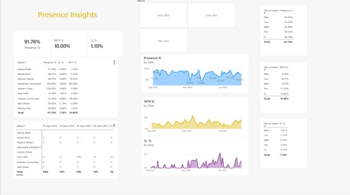

Employee Attendance Analysis Dashboard

Project Overview
This project focuses on analysing employee attendance data using Microsoft Excel and Power BI. The objective is to monitor employee presence, work-from-home patterns and sick leave trends through an interactive dashboard.

Business Objective
- Monitor overall employee attendance.
- Analyse work-from-home and sick leave patterns.
- Identify attendance trends across weekdays and dates.
- Provide employee-level attendance summaries.
- Support data-driven workforce reporting.

Tools & Technologies
- Microsoft Excel
- Microsoft Power BI
- Power Query
- DAX (Data Analysis Expressions)

Dashboard Features
- **Presence %:** Monitor employee presence.
- **WFH %:** Analyse work-from-home trends.
- **Sick Leave %:** Monitor sick leave patterns.
- **Attendance Trends:** Track attendance over time.
- **Weekday Analysis:** Compare attendance across weekdays.
- **Employee Summary:** Review individual employee attendance.

Dashboard Preview
Add your Power BI dashboard screenshots here.

Data Analysis Process
1. Prepared the attendance dataset using Excel.
2. Imported the data into Power BI.
3. Used Power Query for data preparation.
4. Created DAX measures for attendance KPIs.
5. Designed interactive visualisations and dashboard reports.
6. Analysed attendance trends and employee-level metrics.

Project Files
- `Abhishek.pbix` – Power BI dashboard file.

Skills Demonstrated
Excel | Power BI | DAX | Power Query | Data Analysis | Data Visualization | Dashboard Development

## Dashboard Preview

